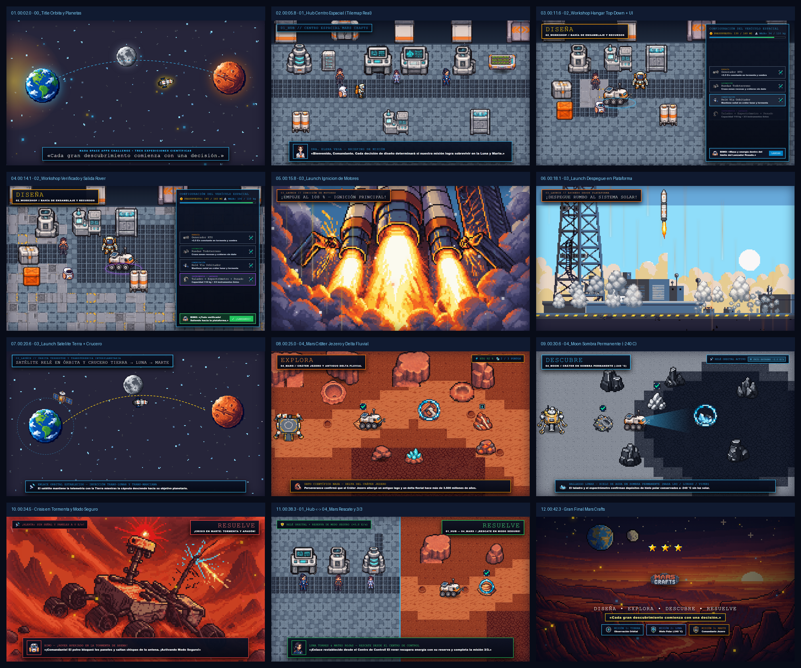

# Guion Técnico y Descripción Segundo a Segundo — Tráiler Oficial de *Mars Crafts* (Edición V5 — Coherencia Visual y Tilemaps Reales)

> **Duración total:** `45.0 segundos` exactos (`1350 frames` @ `30 FPS`, resolución `1920×1080` Full HD)  
> **Tecnología:** Remotion + React + TypeScript (`trailer-remotion/`)  
> **Frase conceptual:** *«Cada gran descubrimiento comienza con una decisión.»*



---

## Mejoras Clave de la Edición V5 (Revisión de Coherencia Visual)

1. **Escena 3 (`02_Workshop` — *Diseña tu misión*) en el Hangar Top-Down Real (sin fondo de IA):**
   - Se eliminó `workshop_background.png` (que mezclaba una imagen de fondo lateral con sprites top-down).
   - Ahora el ensamblaje ocurre en una **Bahía de Ingeniería y Hangar Top-Down** construida celda por celda con el motor `HubTilemap` (`pavimento-1-1..3-5.png`, `floor_panels.png`, `floor_grate.png`, `floor_rivets.png`) y props reales del juego (`estacion-diagnostico.png`, `mesa-laboratorio.png`, `consola-logistica.png`, `esclusa-naranja.png`, `contenedor-blanco.png`, `caja-naranja.png`, `tanques-gemelos.png`).
   - El **Rover top-down real del juego** (`drive_east_000..003.png`) está estacionado sobre la plataforma central de rejilla a la misma escala y perspectiva que **Mateo Rojas**, el **Comandante** y **BIMO**. A la derecha se muestra la interfaz limpia del Taller (`02_Workshop`) verificando presupuesto, masa y energía, y al aprobarse (`✓ ¡LANZAR!`), el rover arranca hacia la rampa de lanzamiento.
2. **Escena 4C (`03_Launch` — Continuidad Despegue → Satélite Terra → Cruising a Luna y Marte):**
   - Se eliminó el corte abrupto a una Tierra gigante con rayo de escaneo y ventana flotante (PiP).
   - Ahora la Toma 4C continúa directamente la escena real `03_Launch` del juego sobre `space_background.png`: a la izquierda se ve la **Tierra** (`planet_earth.png`) con el **Satélite Terra / Relé Orbital** (`earth_satellite_sprite.png`) desplegado en órbita terrestre estableciendo el enlace de telemetría, mientras la **Nave de Crucero** (`cruise_spacecraft.png`) viaja por el arco de trayectoria interplanetaria pasando junto a la **Luna** (`planet_moon.png`) rumbo a **Marte** (`planet_mars.png`).
3. **Generación de Terreno Elaborada (`src/components/GameTilemap.tsx`) y Cero Efectos "PNG Flotante":**
   - **`MarsTilemap`:** Combina orgánicamente las **25 variantes reales de `MarsTilesPNG`** (`mud_a..f`, `mud_hex`, `sand_a..d`, `dunes_a..b`, `dirt_a..b`, `dirt_fine`, `rocky_ground`, `rubble`, `crater_a..e`, `swirl`) para formar el cauce serpenteante del antiguo río y el delta del Cráter Jezero sin rectángulos CSS rotados ni bordes punteados falsos (`dashed`).
   - **`MoonTilemap`:** Combina las **25 variantes reales de `MoonTilesPNG`** para crear la transición natural desde la cresta iluminada hacia la depresión oscura del Cráter Cabeus (`-240 °C`).
   - **`GroundedSprite` (Sombras de Contacto + Orden por Profundidad Y-Sort):** Todos los personajes, vehículos, rocas y módulos proyectan una sombra elíptica de contacto sobre el suelo y se ordenan por coordenada `Y` igual que `YSortCamera` en Unity, eliminando por completo las ventanas Picture-in-Picture flotantes.

---

## Cómo abrir, previsualizar y editar el tráiler

```bash
cd trailer-remotion
npm install
node node_modules/esbuild/install.js
npm start
```

- Se abrirá **Remotion Studio** en `http://localhost:3000`.
- Cada escena es un componente independiente dentro de `src/scenes/`:
  - `Scene01_UniverseAwaits.tsx` (`00:00 – 00:04`)
  - `Scene02_MissionBegins.tsx` (`00:04 – 00:09`)
  - `Scene03_DesignYourMission.tsx` (`00:09 – 00:15`)
  - `Scene04_TheLaunch.tsx` (`00:15 – 00:22`)
  - `Scene05_ExploreMars.tsx` (`00:22 – 00:28`)
  - `Scene06_MoonSecret.tsx` (`00:28 – 00:33`)
  - `Scene07_ControlRescue.tsx` (`00:33 – 00:40`)
  - `Scene08_GrandFinale.tsx` (`00:40 – 00:45`)
- Para exportar el video `.mp4` final en `out/MarsCrafts_Official_Trailer_1080p.mp4`:
  ```bash
  npm run render
  ```

---

## Descripción Detallada de lo que Ocurre en el Video (Segundo a Segundo)

### **ESCENA 1 — El Universo Nos Espera (`00:00 – 00:04` | Frames `0 – 120`)**
- **Archivo:** `src/scenes/Scene01_UniverseAwaits.tsx`
- **Toma 1A (`00:00 – 00:02.5`):**
  - **Visual:** Amanecer orbital sobre el espacio profundo (`space_background.png`). La **Tierra** (`planet_earth.png`), la **Luna** (`planet_moon.png`) y **Marte** (`planet_mars.png`) aparecen en profundidad con el **Satélite Terra** (`earth_satellite_sprite.png`) orbitando la Tierra y la **Nave de Crucero** (`cruise_spacecraft.png`) iniciando la travesía interplanetaria.
  - **Texto inferior:** *«NASA SPACE APPS CHALLENGE • SPACE MISSION DESIGN GAME — Cada gran descubrimiento comienza con una decisión.»*
- **Toma 1B (`00:02.5 – 00:04.0`):**
  - **Visual:** Se despliegan las **3 tarjetas oficiales de misión del menú de Mars Crafts**:
    1. **Misión 1 // Órbita LEO:** *Guardianes de la Tierra* (`mission_earth.png`).
    2. **Misión 2 // Polo Sur (-240 °C):** *El Secreto de la Luna* (`mission_moon.png`).
    3. **Misión 3 // Cráter Jezero:** *Marte: Huellas del Pasado* (`mission_mars.png`).

---

### **ESCENA 2 — El Comienzo de la Misión (`01_Hub`) (`00:04 – 00:09` | Frames `120 – 270`)**
- **Archivo:** `src/scenes/Scene02_MissionBegins.tsx`
- **Visual (escenario top-down del Centro Espacial con `HubTilemap` y `GroundedSprite`):**
  - Piso construido celda por celda con `pavimento-1-1..3-5.png`, paneles de laboratorio (`floor_panels.png`), pasillo central de rejilla (`floor_grate.png`) y muros técnicos con las esclusas (`esclusa-cian.png` y `esclusa-naranja.png`).
  - Todos los objetos y personajes tienen sombra de contacto y orden por profundidad (`Y-sort`): reactor cian (`reactor-cian.png`), servidor, tanques gemelos, consolas de control/investigación, mesa de laboratorio, módulo hidropónico y estación de diagnóstico.
  - **Acción:** El **Comandante** y **BIMO** caminan desde el sector del reactor (donde trabaja **Mateo Rojas**) hacia la **Dra. Elena Vega** y **Luna Torres** para recibir el briefing antes de cruzar la esclusa del Taller.
- **Diálogo inferior:**
  - **Dra. Elena Vega:** *«Tenemos dos destinos listos para explorar: el Cráter Jezero en Marte y la sombra permanente del polo sur lunar.»*
  - **BIMO:** *«¡El Taller está abierto, Comandante! Pero cuidado: el presupuesto y la masa del cohete nos obligan a elegir bien cada pieza.»*

---

### **ESCENA 3 — Diseña tu Misión (`02_Workshop`) (`00:09 – 00:15` | Frames `270 – 450`)**
- **Archivo:** `src/scenes/Scene03_DesignYourMission.tsx`
- **Visual (Bahía de Ensamblaje Top-Down + Interfaz Real del Taller, sin fondos de IA):**
  - **Mitad izquierda (Bahía de Ingeniería Top-Down):** Construida con `HubTilemap` (`pavimento`, `floor_panels`, `floor_grate`) y props reales del juego (`estacion-diagnostico.png`, `mesa-laboratorio.png`, `consola-logistica.png`, `esclusa-naranja.png`, `contenedor-blanco.png`, `caja-naranja.png`, `tanques-gemelos.png`).
  - En el centro de la plataforma de rejilla está el **Rover top-down real del juego** (`drive_east_000..003.png`) en la misma perspectiva y escala que **Mateo Rojas**, el **Comandante** y **BIMO**.
  - A medida que el jugador selecciona cada componente, aparece un destello de integración sobre el chasis del rover. Cuando el diseño queda verificado (`✓ ¡LANZAR!`), el rover enciende motores y avanza por la rejilla hacia la plataforma de despegue.
  - **Mitad derecha (Panel UI del Taller `02_Workshop`):** Muestra las barras reales de **Presupuesto (`130 / 160 M$`)**, **Masa (`98 / 110 kg`)** y **Balance de Energía (`+1.5 E/s`)**, las 4 categorías de componentes con sus íconos oficiales (`ComponentData.icon`), la validación del `Verifier` con BIMO y el botón verde **«✓ ¡LANZAR!»**.

---

### **ESCENA 4 — El Lanzamiento y Travesía Orbital (`03_Launch`) (`00:15 – 00:22` | Frames `450 – 660`)**
- **Archivo:** `src/scenes/Scene04_TheLaunch.tsx`
- **Toma 4A (`00:15 – 00:16.8` — Primer plano cinematográfico de ignición):**
  - **Visual:** Contrapicado pixel art de las 3 toberas del cohete encendiéndose (`rocket_engine_ignition_closeup.png`) con fuego blanco-naranja y vibración de cámara.
- **Toma 4B (`00:16.8 – 00:19.2` — Despegue vertical desde la plataforma):**
  - **Visual:** Escenario real de lanzamiento (`launchpad_background.png`). El cohete (`launch_rocket.png`) despega con su llama animada (`rocket_flame_0..2.png`) y columnas de humo (`launch_smoke_0..2.png`).
- **Toma 4C (`00:19.2 – 00:22.0` — Órbita Terrestre, Satélite Terra y Crucero Interplanetario):**
  - **Visual (continuación directa y coherente del lanzamiento espacial en `03_Launch`, sin ventanas PiP):** Sobre `space_background.png`, a la izquierda se observa la **Tierra** (`planet_earth.png`) con el **Satélite Terra / Relé Orbital** (`earth_satellite_sprite.png`) estacionado en órbita baja estableciendo el enlace de telemetría con el Centro Espacial. Desde la órbita terrestre parte la curva de transferencia por la que viaja la **Nave de Crucero** (`cruise_spacecraft.png`), pasando junto a la **Luna** (`planet_moon.png`, destino Misión 2) rumbo a **Marte** (`planet_mars.png`, destino Misión 3).

---

### **ESCENA 5 — Exploración Planetaria: Marte (`04_Mars`) y La Luna (`04_Moon`) (`00:22 – 00:28` | Frames `660 – 840`)**
- **Archivo:** `src/scenes/Scene05_ExploreMars.tsx`
- **Toma 5A (`00:22 – 00:25.2` — Misión Marte: Cráter Jezero y Delta Fluvial):**
  - **Visual:** Terreno multicapa generado celda por celda con las **25 texturas reales de `MarsTilesPNG`** (lecho de barro seco hexagonal `mud_a..f`/`mud_hex` en el cauce serpenteante del río, bancos de arena `sand_a..d` y dunas `dunes_a..b` en los bordes del delta, suelo marciano `dirt_a..b` y zona rocosa `rocky_ground`/`rubble` con cráteres integrados).
  - Todos los elementos (`landing_module.png`, `meseta-grande.png`, `cantil-largo.png`, `roca-grande.png`, `science_point_sediments.png`, `science_point_special_rock.png`) están anclados al terreno con sombra de contacto y ordenados por `Y`. El rover conduce por el delta y escanea las lutitas (`scan_000..003.png`).
- **Toma 5B (`00:25.2 – 00:28.0` — Misión 2: El Secreto de la Luna en el Cráter Cabeus):**
  - **Visual:** Terreno lunar generado celda por celda con las **25 texturas reales de `MoonTilesPNG`**, mostrando la transición natural desde el regolito iluminado (con el módulo `landing_module_moon.png` y la antena relé `lunar_relay_antenna.png`) hacia la cuenca oscura del **Cráter en Sombra Permanente (`-240 °C`)**.
  - El rover con RTG y Relé Orbital se adentra en la oscuridad con su cono de faros azules y escanea los depósitos de hielo de agua (`science_point_ice.png`).

---

### **ESCENA 6 — El Dilema: Tormenta de Polvo y Modo Seguro (`00:28 – 00:33` | Frames `840 – 990`)**
- **Archivo:** `src/scenes/Scene06_MoonSecret.tsx`
- **Toma 6A (`00:28 – 00:30.6` — Tormenta en el mapa de Marte con Paneles Solares):**
  - **Visual:** En el mapa real de Marte (`MarsTilemap`), una densa tormenta de arena (`mars_dust_texture.png`) reduce la visibilidad en `t = 45s`. Un diseño equipado con **Paneles Solares (`0.0 E/s` bajo el polvo)** y **Batería Pequeña** pierde energía rápidamente frente a la zona rocosa.
- **Toma 6B (`00:30.6 – 00:33.0` — Primer plano dramático y activación del Modo Seguro):**
  - **Visual:** Plano dramático del rover en medio de la tormenta (`rover_sandstorm_crisis.png`). En lugar de un "Game Over", el sistema activa el **Modo Seguro (`+0.8 E/s`)** y BIMO explica qué decisión de diseño lo causó, invitando a rediseñar.

---

### **ESCENA 7 — Reporte, Rediseño y Victoria (`05_Report` → `04_Mars`) (`00:33 – 00:40` | Frames `990 – 1200`)**
- **Archivo:** `src/scenes/Scene07_ControlRescue.tsx`
- **Visual (pantalla dividida entre el Centro Espacial/Taller y la Superficie de Marte, sin ventanas flotantes):**
  - **Mitad izquierda (`01_Hub` / `02_Workshop`):** El equipo analiza el reporte causa → decisión y aplica el botón **Rediseñar**, cambiando a **Generador RTG (`+2.5 E/s` inmune al polvo)** + **Ruedas Todoterreno** + **Antena de Alta Ganancia**.
  - **Mitad derecha (`04_Mars`):** El rover rediseñado atraviesa la zona rocosa en plena tormenta sin perder energía y completa el tercer punto científico (`3/3 PUNTOS COMPLETADOS • ★★★`).

---

### **ESCENA 8 — Gran Final (`00:40 – 00:45` | Frames `1200 – 1350`)**
- **Archivo:** `src/scenes/Scene08_GrandFinale.tsx`
- **Visual:**
  - Horizonte panorámico de Marte al atardecer (`finale_commander_mars_horizon.png`).
  - Aparecen las **3 estrellas doradas** (`star_full.png`), el **logo oficial de Mars Crafts** (`mars_crafts_logo.png`), los pilares **«DISEÑA • EXPLORA • DESCUBRE • RESUELVE»**, la frase conceptual **«Cada gran descubrimiento comienza con una decisión.»** y las tarjetas de las misiones **Marte**, **Luna** y **Tierra**.
